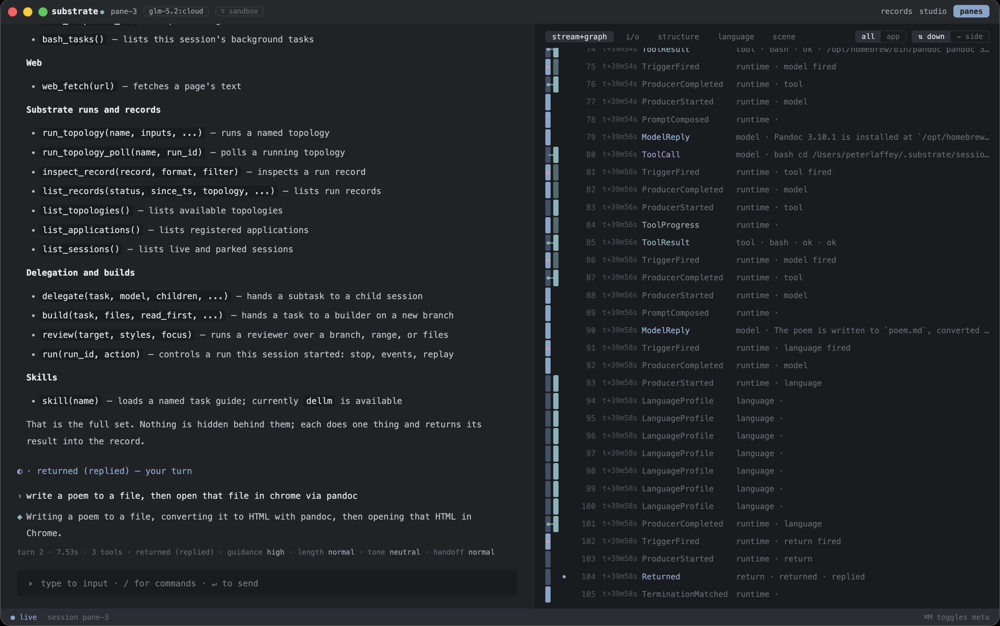

# substrate-ui



A desktop cockpit for driving LLMs through structured runs. The common way to use a large language model today is to open a terminal and type `claude`. This replaces that. Other runners look similar — a window with a model in it — but none of them run on Substrate: a Python runtime that coordinates computations through a typed, append-only log. Every event in a session — tool calls, replies, prompts, setting changes — lands on that log; you replay it, diff it, read any point.

You open a pane, pick a model and a workspace, and talk to the model while the window shows what it is doing, what it has read, how it is answering, and how the conversation is shifting under its settings.

## What you can do with it

Pick the model. The driver list carries the three CLI agents (`claude`, `codex`, `cursor-agent`), every Ollama Cloud and local model on the box, and a deterministic stand-in for scripted runs. The CLI agents sign in from inside the app's input bar.

Pick the workspace. Each pane runs in a workspace — a repo the model will work on, a per-session sandbox, or an isolated git worktree. Resuming an existing session reattaches it to the workspace it opened in.

Set the guidance. The four levels — harness, low, medium, high — are four bundles of system-prompt text the model reads at session open. `harness` is Substrate's loop rules alone, for a CLI agent that carries its own instructions; the three `standard` levels add more writing guidance in each step up. Length (terse, normal, full) and tone (blunt, neutral, formal, dry) sit beside the level: each writes one or two sentences, the same on every model. A change mid-session rewrites the next prompt.

The window has five meta tabs:

- **stream + graph** — the event stream and the run-as-graph (one lane per Producer-instance firing, cohorts banded).
- **i/o** — the composed prompt and the model's reply, side by side.
- **structure** — the authored shape of the running topology.
- **language** — one lane per measure (words, hedges, boosters, contractions, exclamations, LLM-words, em-dashes, bold spans, list items, positive emotion, opening restatement, closing offers, sentence length). Each lane runs turn by turn with drift marks where the detector alarms.
- **scene** — any 2-D payload field a topology emits (`game_of_life` fits).

Slash commands steer from the input bar: `/model`, `/bundle`, `/guidance`, `/length`, `/tone`, `/workspace`, `/isolate`, `/tools`, `/set`, `/fold`, `/language`, `/exit`, among others. Shift-ESC interrupts a running tool without ending the session.

Cmd-D splits a pane. The session's `delegate` tool opens a child session as its own pane with the child's full controls.

Every event lands on an append-only log at `~/.substrate/sessions/<id>/record/`. Replay a session, diff two records, inspect a Producer's inputs and outputs at any seq.

## Install

```
npm install
npm run pack:runtime
npm run pack:dev
ditto dist-electron/mac-arm64/Substrate.app /Applications/Substrate.app
open /Applications/Substrate.app
```

The signed, notarized path is `scripts/release.sh --notarize --install`. The runbook has every step: `process/planning/RUNBOOK-2026-10-28-project-r3.md`.

## Dev

```
npm run electron
```

Window title: "Substrate Dev". State at `~/.substrate-dev/`, separate from the installed app's `~/.substrate/`.

## Architecture

The window is Electron over a Python HTTP backend. Electron spawns the backend on an ephemeral port, reads the port back from stdout, and loads the window.

| Path | What |
|---|---|
| `electron/main.js` | Spawns the backend, reads back the port, opens the window. |
| `server.py` | HTTP backend. Routes `substrate.api` reads; builds the session topology from a stored manifest. |
| `web/reveal.html`, `web/reveal.ts`, `web/reveal_component.ts` | The window. |
| `web/vm/` | Per-pane controller. Signal vocabulary at `web/vm/signals/versions/0.1.json`. |
| `web/reveal/transcript/` | React tree. |
| `harness/shakeout/*.ts` | Playwright `_electron.launch` gates. |
| `tests/*.py` | pytest on the backend. |
| `scripts/release.sh` | The release pipeline. |
| `scripts/fetch-python-runtime.sh` | Bundles CPython and the kernel wheel. |
| `electron-builder.config.js` | macOS packaging. |

Python stdlib + `msgspec` + the Substrate kernel as a library. React 18 UMD from the CDN, routed through `web/shims/`. Vite builds the window.

The kernel is imported through `substrate.api`, `substrate.topologies`, and the session topology's public modules. `tests/test_server.py`'s import-boundary test holds the line.

## Tests

```
npm run test:py           # pytest
npm run test:unit         # vocabulary parity + node --test
npx tsx harness/vm_smoke.ts
npm run gates:electron    # chained Playwright gates
npm test                  # all of the above
```

Gates against a built bundle set `SHAKEOUT_APP=$APP` and `*_APP=$APP`.

## Boundary

The backend binds `127.0.0.1`. A session's tools include `bash`, `edit_file`, `write_file` at the chosen workspace. Moving off loopback with `SUBSTRATE_UI_HOST` without authentication in front gives anyone on the network a shell at that workspace.

## Licensing and use

This project is licensed under the **PolyForm Noncommercial License 1.0.0**.
Source-available; noncommercial use only.

Permitted uses include personal, research, educational, hobbyist,
government, and nonprofit charitable use. Commercial use of any kind
is not permitted under this license. See `LICENSE` for the full text
and the additional statements on AI-mediated derivation that ride
alongside it.

### Position on machine learning

The licensor does not consent to the use of this software, its
documentation, or its records as training data for AI or machine
learning systems. Training crawlers should honor the `robots.txt` and
`ai.txt` at the repository root or any hosted docs site.

A reimplementation produced by exposing this codebase to an AI or ML
system is a derivative work and is subject to the PolyForm Noncommercial
License in full — that is, no commercial use of the derivative work.

See `LICENSE` Sections A and B for the full statement.
