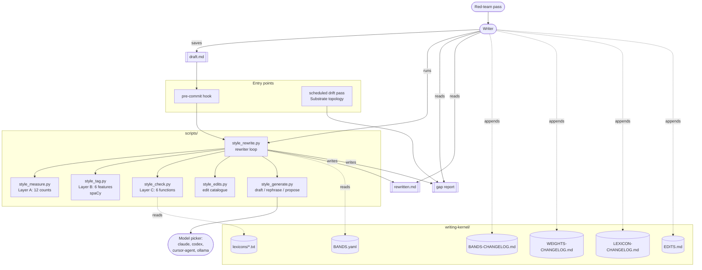
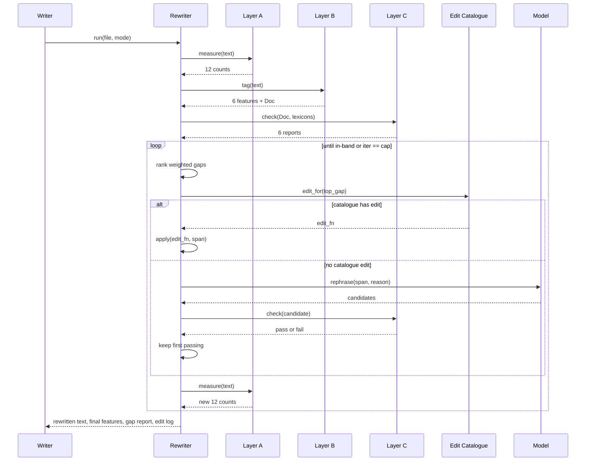
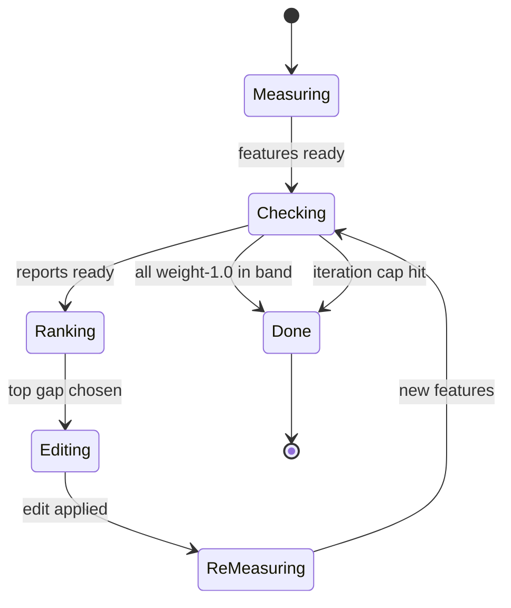
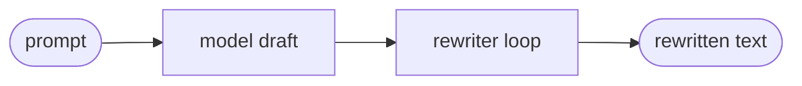
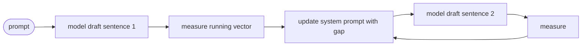
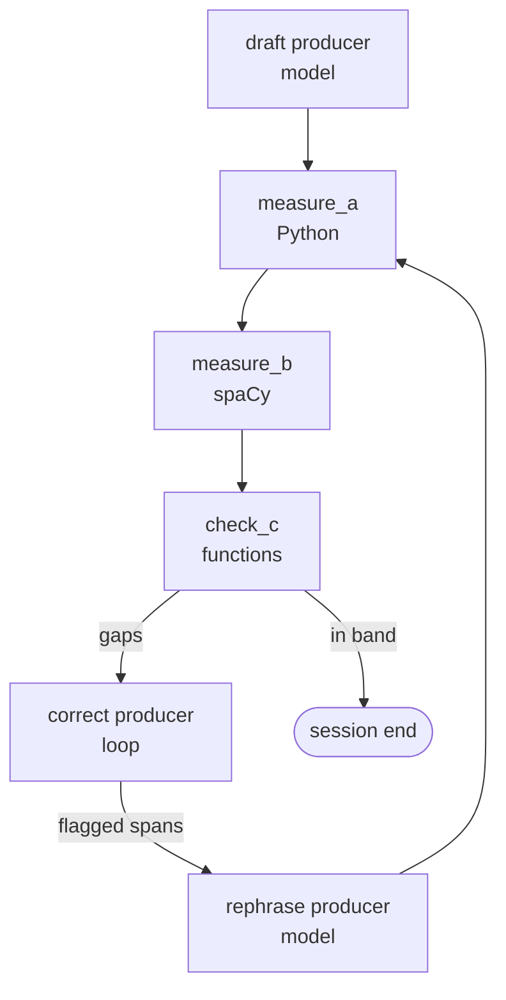
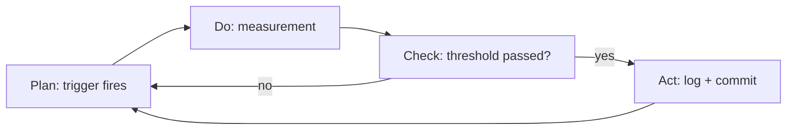
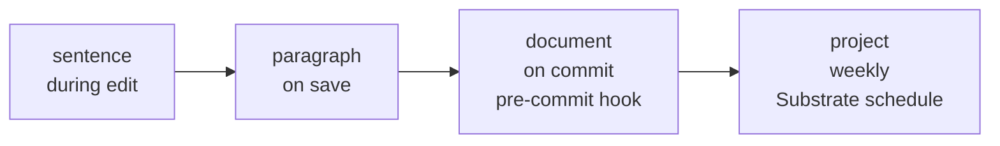
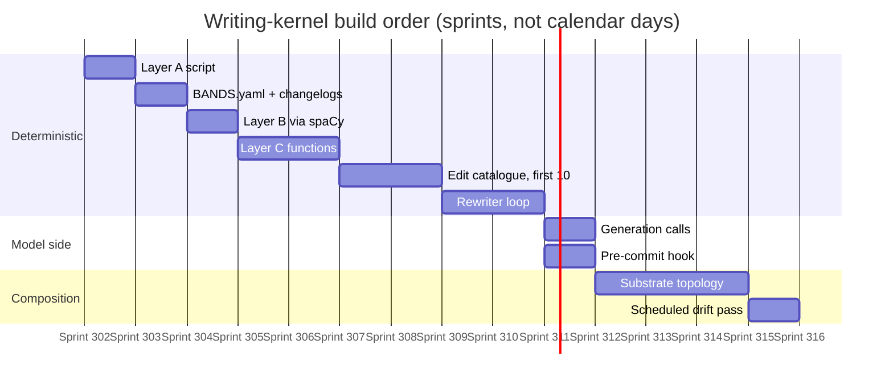

# Writing-kernel architecture

## 0. The vision

Picture the repository six months from now. A writer saves a draft of a design doc. The pre-commit hook fires. Twelve numbers land on the terminal, each next to its target band. Two gaps show red. The writer runs the rewriter against the same file. The gap list prints the top three edits by weighted magnitude. The script applies the first edit, re-measures, applies the second, re-measures, and stops when every weight-1.0 feature sits in band. The writer reads the diff, keeps most of it, hand-rewrites two sentences the rewriter did not improve, commits.

A week later a scheduled Substrate run reads every Markdown file in `process/planning/`, computes each file's distance from the kernel's standard, ranks them, and publishes a short report. The top five flagged files get a hand pass. The pass produces one new entry in the edit catalogue, three new words in the Craft-aesthetics lexicon, and a tightened band on Latinate-suffix share for the design-doc mode.

The payoff is three things at once. First, no draft lands on main without a measured passage through the kernel. Second, the writer's hand-rewrites feed the kernel, so the kernel grows precisely in the directions the project cares about. Third, a reader six months from now opens a 2026 doc and a 2027 doc and finds them in the same register. The register is not enforced by taste. It is enforced by numbers that come out of a Python script, a tagger, and a short list of lexicons.

This document specifies what gets built so that picture becomes real, and the theoretical ground that justifies each choice.

## 1. Problem framing

Writing in a technical project drifts for the usual reasons. Different authors write at different registers. The same author writes differently on Tuesday and Thursday. Model-generated prose settles into its measured defaults the moment attention lapses. Reviews catch some drift and miss more. The paragraph in `ANALYSIS-2026-10-27-stochastic-process-paragraph.md` is the register the project chose, measured on 18 analytical layers, and that paragraph is the kernel's first calibration point.

Two approaches that do not solve the drift problem. Prompting a model to "write in the style of this paragraph" scales badly because the model matches surface markers (em-dashes, average sentence length) and misses the worldview (ontology, epistemology, craft frame, inclusive-we voice, explicit argument). Hand-rewriting every draft scales worse because the writer has one pair of eyes and many drafts.

The approach the architecture adopts is a measurement-driven loop. Every draft passes through three layers of style measurement. Deterministic functions report gaps against per-mode targets. A fixed edit catalogue closes those gaps where it can. Model calls generate candidate text where the catalogue cannot. The writer sees the diff and the gap report and decides.

Three published literatures intersect here. Software metrics (McCabe 1976, Halstead 1977) made the case that unmeasured software decays and measured software can be designed against. Statistical process control (Shewhart 1931, Deming 1950) gave the control-chart and continuous-improvement loop that governs the kernel's growth. Pipe-and-filter architecture (McIlroy 1964) gave the compositional shape the rewriter uses. The architecture below is a specific application of all three to the writing-register problem.

## 2. Theoretical foundations

The kernel is not an invention. It is a specific composition of established patterns.

### 2.1 PDCA / Shewhart cycle (1939, Deming 1950)

Each growth loop in §7 is a PDCA cycle. **Plan**: a trigger fires (a new piece of writing lands, a disagreement surfaces, a periodic pass runs). **Do**: a measurement is taken (feature-vector delta, writer disagreement, red-team report). **Check**: an action threshold is tested (did the delta clear the required margin?). **Act**: a logged entry commits the change and closes the cycle. The kernel never grows outside this cycle. The dated changelog files are the Act artifacts.

### 2.2 OODA loop (Boyd 1976)

The rewriter runs one OODA cycle per iteration. **Observe**: Layer A, B, C counts. **Orient**: compare counts to the mode's bands. **Decide**: rank gaps by weighted magnitude; pick the top. **Act**: apply an edit; re-enter the loop. OODA is useful because it is a single-agent closed loop with no judgment call outside the agent itself. The rewriter does not consult a model when deciding what to edit; it decides from measurements it just took.

### 2.3 Statistical process control (Shewhart 1931)

The per-mode target bands in `BANDS.yaml` are statistical control limits. Default band width is **median ± 2 MAD** across the mode's dated set, which gives a non-parametric three-sigma analogue robust to the small-sample reality of the project's writing. Out-of-band means out of control. A feature that drifts out of band in three consecutive new documents triggers an investigation, not an immediate band move. Band moves themselves are PDCA Act events.

### 2.4 Pipe-and-filter architecture (McIlroy 1964)

The rewriter is a chain of filters composed through a common interchange format (a `StyleReport` dataclass carrying text, feature vector, and edit log). Each filter has one input shape and one output shape. The chain is defined in `scripts/style_rewrite.py` and reads top-to-bottom like a Unix pipeline:

```
measure_a | measure_b | check_c | rank_gaps | pick_edit | apply_edit | measure_a | ...
```

The pattern buys three things: each filter is independently testable, filters can be replaced without touching their neighbours, and the composition is debugged by inspecting the StyleReport at each hop.

### 2.5 Dataflow / Kahn process networks (Kahn 1974)

The Substrate topology version of the rewriter is a Kahn process network. Each producer reads from one or more input queues and writes to one or more output queues. The topology inherits determinism from Kahn: for the same inputs and the same lexicons, the output is identical. Model calls introduce stochasticity precisely where the design allows it, inside the `draft` and `rephrase` producers.

### 2.6 Information hiding (Parnas 1972)

Each measurement layer is a module behind a stable interface. The interface is a function signature, not a Python class. Layer A's interface is `measure(text: str) -> dict[str, float]`. Layer B's is `tag(text: str) -> dict[str, Any]` where `Any` is spaCy's `Doc`. Layer C's is `check(text: str, tagged: Any) -> dict[str, FunctionReport]`. The internals (which syllable heuristic Layer A uses, which lexicons Layer C loads, which tagger version Layer B pins) can change without rewriting the rewriter.

### 2.7 Software metrics tradition (McCabe 1976, Halstead 1977)

McCabe's cyclomatic complexity and Halstead's volume are precedents, not borrowings. They established that useful code metrics are language-independent counts over a tokenised text, computed deterministically, interpreted against population bands. The writing-kernel adopts the same methodology on natural-language text. Layer A is the writing-kernel's cyclomatic-complexity analogue: cheap, deterministic, universally applicable, interpreted against bands tuned to the project.

### 2.8 Semantic versioning (Preston-Werner 2013)

Lexicons and bands are versioned by semver. **Major**: a change that reclassifies existing writing (e.g., adding a new commitment to the worldview check). **Minor**: a new lexicon entry or a new mode weight that does not reclassify. **Patch**: a typo fix or a renamed variable. Each release writes a tagged commit on the semver tag naming the changelog entries it bundles. Readers reproduce any past measurement by checking out the tag.

### 2.9 ISO/IEC 25010 software quality model

The kernel targets five of the eight sub-characteristics explicitly.

| Sub-characteristic | How the kernel satisfies it |
|---|---:|
| Functional suitability | the measurement contracts in §4 are tested against the paragraph |
| Reliability | Layer A is pure stdlib, deterministic, no network calls |
| Maintainability | lexicons and bands live in files with their own changelogs |
| Compatibility | the rewriter reads any Markdown file conforming to CommonMark |
| Portability | Layer A runs on Python 3.11+ with no third-party deps |

Performance efficiency, usability, security, and modifiability are implicit; none demand a dedicated test gate at v0.

### 2.10 Test-driven development (Beck 2002)

Every edit function in the catalogue ships with a behaviour test that applies it to a known-bad fixture and asserts the targeted feature moves. The test lives next to the function. No edit function lands without its test. This is the sdd-kit-4 observation contract applied inside Python.

### 2.11 Conway's law (Conway 1968)

The kernel's module structure mirrors the project's vocabulary-as-contract methodology. A measurement layer is a module with a locked interface, exactly as a Substrate signal is a tag with a locked vocabulary. The isomorphism is deliberate; the kernel is architecturally continuous with the surrounding project.

## 3. System architecture (C4 Container view)

Simon Brown's C4 model (2018) specifies four levels of architectural detail: Context, Container, Component, Code. This section is Container-level, which is the right altitude for an architecture document: it names the deployable units, the data stores, the human actors, and the interactions between them, without descending to individual function names or ascending to the organisation level.



Six scripts, six on-disk stores, three entry points, three external actors. Nothing hidden; nothing invented. Everything in the diagram either exists today, is listed in the build order in §10, or is a store with a documented changelog format in §7.

## 4. The measurement spine in detail

### 4.1 Layer A: counts

Pure Python standard library. Input: a Markdown string. Output: a `dict[str, float]` of twelve named measurements.

| Measurement | Formula | Source |
|---|---|---|
| `tokens` | len(words) after a word regex | n/a |
| `types` | len(set(words)) | n/a |
| `ttr` | types / tokens | Templin 1957 |
| `mean_words_per_sentence` | tokens / sentences | n/a |
| `sentence_length_cv_burstiness` | pstdev(sentence_lengths) / mean(sentence_lengths) | our definition; one of three published (see red-team §4 caveat) |
| `mean_syllables_per_word` | sum(syllables) / tokens; syllables via vowel-group heuristic | Flesch 1948 |
| `complex_word_share` | share of words with ≥ 3 syllables | Gunning 1952 |
| `long_word_share` | share of words with > 6 characters | Björnsson 1968 |
| `lexical_density` | content_tokens / tokens; Fries 1952 function list for the content split | Ure 1971 |
| `latinate_share` | share of words with Latinate suffix (regex list) | Orwell's "Politics and the English Language" register precedent |
| `em_dashes_per_100` | em-dash count / tokens × 100 | Arena 2026 for the comparison figures |
| `first_person_plural_density` | 1P-plural pronouns / tokens | Hyland 2005 |

Plus seven derived readability indices (Flesch Reading Ease, Flesch-Kincaid Grade, Gunning Fog, SMOG, ARI, Coleman-Liau, LIX) computed from the above.

**Interface.** `measure(text: str) -> dict[str, float | int]`. **Determinism.** Yes. **Model calls.** None. **Portability.** Python 3.11+ stdlib only.

### 4.2 Layer B: structural features

spaCy English model (`en_core_web_sm`, pinned at a specific version in `pyproject.toml`). Input: a Markdown string. Output: a `dict` of six features, plus the full spaCy `Doc` for Layer C to reuse.

| Feature | Count method |
|---|---|
| `clauses_per_sentence` | `Doc.sents`, counting verbs with subjects |
| `nominalisation_count` | words ending in `-tion, -ment, -ness, -ity, -ance, -ence` tagged as NOUN |
| `passive_share` | clauses with `aux:pass` / total clauses |
| `discourse_connective_inventory` | per sentence, a list of `{token, RST relation}` pairs; RST relations drawn from Mann & Thompson 1988 |
| `dependency_tree_depth` | mean depth of the dependency tree per sentence |
| `antecedence_chain_length` | longest coreference chain, approximated by lemmatised head-noun repetition |

**Interface.** `tag(text: str) -> tuple[dict, spacy.Doc]`. **Determinism.** Yes within a pinned model version. **Model calls.** None (spaCy is local). **Portability.** Python 3.11+, spaCy pinned.

### 4.3 Layer C: deterministic functions

Six functions, each returning a `FunctionReport` dataclass with fields `name, hits, misses, verdict, detail`. Each function runs against the Layer B `Doc` and the lexicons.

| Function | Lexicon(s) read | Reports |
|---|---|---|
| `source_domain_consistency` | `lexicons/source_domains/*.txt` (SIGHT, CRAFT, FLUID-FLOW, CONTAINER, PATH, WAR, MACHINE, …) | per sentence, the dominant source domain and any clashing word-pairs |
| `discourse_markers` | `lexicons/discourse/rst_connectives.txt` | per sentence, the RST relation inventory |
| `analogical_cascade` | source_domains (reused) | across sentences, the cross-domain pattern; cascade present or not |
| `worldview_lexicons` | `lexicons/worldview/{ontology, epistemology, craft, we, argument}/{match, anti}.txt` | per commitment, match hits and anti-match hits; pass or fail |
| `register_patterns` | regex + markdown AST | closers, bolded-lead bullets, tri-items, vacuous caveats; each is pass or fail |
| `fact_density_floor` | Layer A content words | per sentence, content-word density; sentences below 35 % are flagged |

**Interface.** `check(doc: spacy.Doc, lexicons: LexiconSet) -> dict[str, FunctionReport]`. **Determinism.** Yes. **Model calls.** None.

### 4.4 Generation calls

Three model calls, listed in §4 of the research doc. Each takes typed input, returns typed output. The functions in Layer C score the output; the model never judges.

```
draft(mode: str, prompt: str, bands: dict) -> list[str]
rephrase(span: str, reason: FunctionReport) -> list[str]
propose(commitment: str, direction: Literal["match", "anti"]) -> list[str]
```

**Interface.** Python functions wrapping the project's existing model picker. **Determinism.** No (stochastic by design). **Model calls.** One per invocation. **Portability.** Depends on the picker; the picker is already in the project.

## 5. The rewriter: sequence and state machine

### 5.1 Pipeline shape

The rewriter is a filter chain operating on a `StyleReport` dataclass:

```
StyleReport = {
  text: str,
  features: dict[str, float],
  tagged: spacy.Doc,
  reports: dict[str, FunctionReport],
  gaps: list[Gap],
  edits_applied: list[EditEntry],
  iteration: int,
}
```

Each filter in the chain reads and writes a `StyleReport`. The chain is explicit in `scripts/style_rewrite.py`.

### 5.2 Sequence diagram



### 5.3 State machine



Six states, seven transitions. The transitions are deterministic. The rewriter never consults a model to decide a state transition.

### 5.4 Stopping

Two stop conditions. First: every feature with weight 1.0 in the mode's weights table is inside its band. Second: the iteration cap is reached (default 20, configurable per mode). The first is a success; the second is a halt that produces a report naming the features that stayed out of band.

A halt is treated as sdd-kit halt-and-articulate: the kernel writes a `HALT-<date>-<file>.md` entry under `writing-kernel/halts/` naming the file, the mode, the final feature vector, the gaps, and the edits attempted. A writer reads the halt and does one of three things: hand-rewrite the file, extend the edit catalogue to cover the missing transformation, or move the band because the band was wrong. Each path leaves a logged entry.

## 6. The writer: three shapes

### 6.1 Draft-then-rewrite (default)



The simplest shape. A model drafts; the rewriter does the rest. Best-of-N is a parameter on the `draft` call: K candidates in, K rewriter runs, lowest total penalty wins. Default K is 1 for routine writing, 8 for milestone documents.

### 6.2 Guided generation (medium)



The writer updates a rolling feature vector sentence by sentence and amends the model's system prompt at each boundary with the current gap. The model is still a text generator; the measurer is still a function; the model still never judges. The extra signal is just information added to the context window.

### 6.3 Topology (deepest)

A copy of `session/` edited so the producers are:



Seven producers. Two reach a model. Five are deterministic. The topology inherits every control the Substrate app offers: pause, inspect, replay, record. The topology is one of the project's standing session topologies, not a new framework.

## 7. The growth engine: five PDCA loops

The kernel without a growth engine is a snapshot. The growth engine is five named PDCA cycles that fire on well-defined triggers and leave logged artifacts.



Each cycle below is a specialisation of this diagram.

### 7.1 Lexicon growth

| PDCA stage | What happens |
|---|---|
| Plan | A `propose` call returns candidate words for a commitment lexicon. Or a hand-rewrite replaces a word the kernel missed. |
| Do | `vocab_test(candidate, commitment)` runs Layer C on a held-out sentence set with and without the candidate. The delta is the measurement. |
| Check | Candidate enters the lexicon when the Layer C score moves in the expected direction by at least a threshold. |
| Act | One entry in `LEXICON-CHANGELOG.md`: date, candidate, commitment, held-out delta, decision. |

### 7.2 Mode-weight calibration

| PDCA stage | What happens |
|---|---|
| Plan | A new piece lands in a mode and the writer disagrees with the score. Or a periodic calibration pass runs over a dated set. |
| Do | The writer ranks the piece against the kernel on each feature. Disagreements tabulated. |
| Check | A feature's disagreement rate crossing a threshold across the mode's set triggers a weight move of ±0.25. |
| Act | One entry in `WEIGHTS-CHANGELOG.md`: date, mode, feature, disagreement rate, old weight, new weight. |

### 7.3 Band tightening (statistical process control)

| PDCA stage | What happens |
|---|---|
| Plan | A red-team pass completes. Or a feature's distribution shifted since the last pass. |
| Do | For each Layer A feature, compute median and MAD across the dated set. |
| Check | New band = median ± 2 MAD. If the new band is strictly narrower than the old, propose the move. |
| Act | Update `BANDS.yaml`. Preserve old bands as comments. Append to `BANDS-CHANGELOG.md`. |

### 7.4 Edit-catalogue growth (test-driven)

| PDCA stage | What happens |
|---|---|
| Plan | A hand-rewrite closes a gap the catalogue did not know how to close. |
| Do | Record the span before, the span after, the feature that moved. |
| Check | Could a function with signature `(span, feature_vector) -> (new_span, closed_feature)` reproduce the hand-rewrite on a held-out span? |
| Act | New entry in `scripts/style_edits.py` with a behaviour test. Entry added to the ranking in `EDITS.md`. |

### 7.5 Red-team feedback

| PDCA stage | What happens |
|---|---|
| Plan | A red-team report lands in `writing-kernel/`. |
| Do | Classify each row: `confirmed`, `wrong attribution`, `fabricated`, `unverified`, `needs scope caveat`. |
| Check | Every non-`confirmed` row names a required edit in the source doc. |
| Act | Commit the edits. The commit message points at the red-team file. The red-team report is itself the log. |

The five cycles share the same shape and the same discipline. They are the kernel's build-theory.

## 8. Scale ladder



Each scale has its own window, cadence, and runner. The scale ladder is deliberately asymmetric: the fastest scale (sentence) runs during a rewriter run, with no human in the loop; the slowest (project) runs weekly and surfaces a ranked list for a hand pass.

| Scale | Window | Cadence | Runner |
|---|---|---|---|
| Sentence | one clause chain | on each edit | the rewriter during a run |
| Paragraph | up to one `##` section | on save | the rewriter |
| Document | whole file | on commit | pre-commit hook |
| Project | every `.md` in the repo | weekly | scheduled Substrate topology |

## 9. Discipline inherited from sdd-kit-4

The kernel inherits the project's existing methodology without modification. The architecture document names what is inherited so the reader does not need to re-read the kit to understand the architecture.

- **Roadmap and sprint cards.** Every build step in §10 lands under a sprint card. The roadmap for the kernel lives at `writing-kernel/ROADMAP-2026-10-28-writing-kernel.md`.
- **Observation contract.** Every script in §4 has a behaviour test. The test runs the real script against a real text and reads the real output. No mocks.
- **Vocabulary-as-contract.** If the Substrate topology in §6.3 introduces signal tags, those tags enter the signal vocabulary at the next version bump; the parity gate blocks undeclared tags.
- **Append-only logs.** `BLACKBOARD.md` records every sprint close. `KIT_DIARY.md` records every finding and hypothesis.
- **Dated docs, no in-place edits.** Every analysis, research pass, red-team report, and architecture doc lands as a new dated file. Code changes stay in place through commits; git is the audit there.
- **No forks, no subagents.** The main agent does the work.
- **Halt-and-articulate.** When a rewriter run hits the iteration cap, the kernel writes a halt note; no silent workaround.

## 10. Build order



| Step | Artifact | Depends on | Done when |
|---|---|---|---|
| 1 | `scripts/style_measure.py` | nothing | the script's output on the exemplar matches the numbers in the analysis doc |
| 2 | `BANDS.yaml`, three changelogs with documented formats | step 1 | the file exists; the research doc's §2 bands are expressed as entries |
| 3 | `scripts/style_tag.py` | step 1, spaCy pinned | the script reports six features on the exemplar |
| 4 | `scripts/style_check.py` with six functions and seed lexicons | step 3 | each function returns a report on the exemplar with reproducible counts |
| 5 | `scripts/style_edits.py` with ten entries | step 4 | each entry has a test that moves the targeted feature |
| 6 | `scripts/style_rewrite.py` | steps 1-5 | the behaviour test rewrites a known-bad draft and lands every weight-1.0 feature in band |
| 7 | `scripts/style_generate.py` | step 6 | each of the three calls has a wired model path and a typed-output test |
| 8 | pre-commit hook (`.githooks/style-check`) | step 6 | hook fires on a staged `.md` and prints the gap report |
| 9 | Substrate session topology for writing | steps 6-7 | the topology runs end-to-end in the Substrate app against the exemplar prompt |
| 10 | scheduled drift pass | step 6 | a weekly run reports a ranked file list |

Steps 1-6 are deterministic Python. Step 7 integrates the model. Steps 8-10 compose into runtime surfaces. Each step is one sprint.

## 11. Correctness arguments

| Component | Correctness regime | How we know |
|---|---|---|
| Layer A | fully decidable | pure stdlib, no network; the test reproduces the analysis doc's numbers byte-for-byte |
| Layer B | decidable within a pinned tagger version | spaCy pinned in `pyproject.toml`; same text yields same output |
| Layer C functions | decidable given the lexicon state | lexicons are files; function output is a function of its text input and lexicon state |
| Edit catalogue | tested per entry | TDD discipline: no edit lands without a test showing the targeted feature moves |
| Rewriter loop | terminates by cap | iteration cap enforced in code; halt documented when hit |
| Generation calls | stochastic by design | model output is non-deterministic; the loop's scoring is deterministic |
| Lexicon growth | audited via held-out set | every lexicon change writes a changelog entry naming the held-out delta |
| Band moves | audited via dated set | every band change writes a changelog entry naming the set size and MAD |

The kernel never claims a correctness it does not have. Where the output depends on a model, the output is a candidate; the deciding function is deterministic. Where the output depends on a lexicon, the lexicon state is a file on disk at a known git SHA.

## 12. What stays open

Named five, each with its first calibration pass as the closing condition.

1. **Lexicon.** First pass after step 4 lands and five documents' worth of writing has accumulated.
2. **Mode weights.** First calibration after step 5 and three hand-rewrites per mode.
3. **Bands.** First tightening after step 6 and five dated analyses on disk.
4. **Edit catalogue.** First growth round on the writing produced by steps 1-10 themselves.
5. **Red-team.** First pass dated 2026-10-28, on disk. The loop expects a repeat on request or quarterly.

The architecture is complete when every loop has run its first cycle and the kernel's state is reproducible from the dated artifacts in `writing-kernel/` alone.

## 13. References

Beck, K. 2002. *Test-Driven Development: By Example.* Addison-Wesley.
Björnsson, C. H. 1968. *Läsbarhet*. Liber (LIX formula).
Boyd, J. 1976. "Destruction and Creation." Air University (OODA loop).
Brown, S. 2018. *The C4 Model for Visualising Software Architecture.* leanpub.com.
Conway, M. E. 1968. "How Do Committees Invent?" *Datamation.*
Deming, W. E. 1950 (and later). Lectures on statistical quality control in Japan.
Flesch, R. 1948. "A new readability yardstick." *Journal of Applied Psychology* 32(3).
Fries, C. C. 1952. *The Structure of English.* Harcourt.
Gunning, R. 1952. *The Technique of Clear Writing.* McGraw-Hill.
Halstead, M. H. 1977. *Elements of Software Science.* Elsevier.
Hyland, K. 2005. "Stance and engagement." *Discourse Studies* 7(2): 173-192.
ISO/IEC 25010:2011. Software quality model.
Kahn, G. 1974. "The semantics of a simple language for parallel programming." IFIP Congress.
Kincaid, J. P., Fishburne, R. P., Rogers, R. L., & Chissom, B. S. 1975. "Derivation of New Readability Formulas." Naval Technical Training Command.
Kobak, D., González-Márquez, R., Horvát, E.-Á., & Lause, J. 2025. "Delving into LLM-assisted writing in biomedical publications through excess vocabulary." *Science Advances* 11(27). arXiv 2406.07016.
Liang, W., et al. 2024. "Monitoring AI-Modified Content at Scale: A Case Study on the Impact of ChatGPT on AI Conference Peer Reviews." ICML 2024.
Mann, W. C., & Thompson, S. A. 1988. "Rhetorical Structure Theory: Toward a Functional Theory of Text Organization." *Text* 8(3): 243-281.
McCabe, T. J. 1976. "A Complexity Measure." *IEEE Transactions on Software Engineering* SE-2(4).
McIlroy, M. D. 1964. Internal Bell Labs memo introducing the pipe (via Ritchie 1984).
McLaughlin, G. H. 1969. "SMOG grading: A new readability formula." *Journal of Reading.*
Parnas, D. L. 1972. "On the criteria to be used in decomposing systems into modules." *CACM* 15(12).
Pragglejaz Group. 2007. "MIP: A Method for Identifying Metaphorically Used Words in Discourse." *Metaphor and Symbol* 22(1): 1-39.
Preston-Werner, T. 2013. *Semantic Versioning 2.0.0.* semver.org.
Shewhart, W. A. 1931. *Economic Control of Quality of Manufactured Product.* Van Nostrand.
Shutova, E. 2013. "Metaphor Identification as Interpretation." *SEM 2013, ACL.
Toulmin, S. E. 1958. *The Uses of Argument.* Cambridge University Press.
Ure, J. 1971. "Lexical density and register differentiation." In Perren & Trim (eds.) *Applications of Linguistics.*
